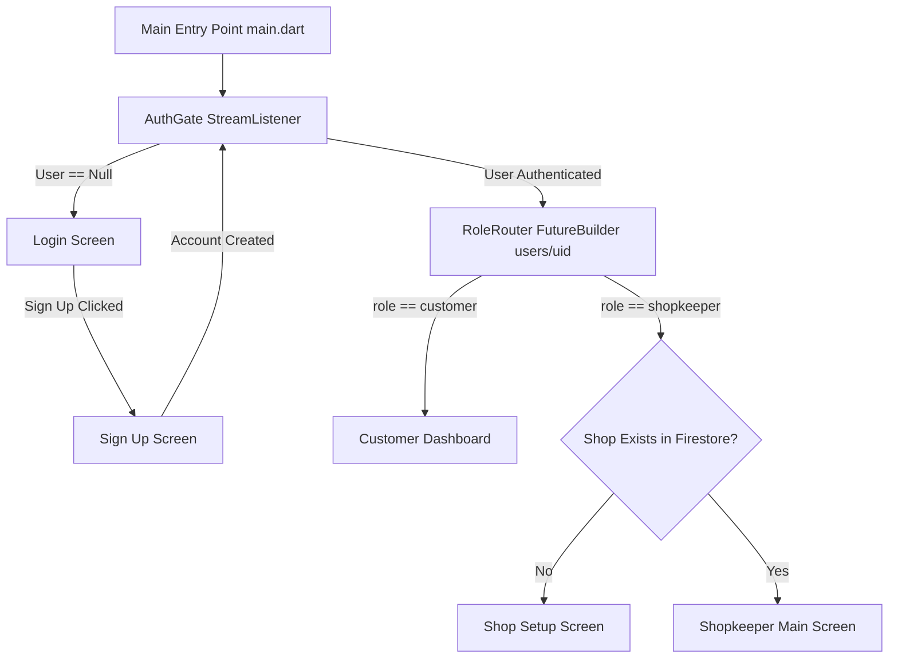

# DUKAN SATHI — Full Functional & Structural Specification
*Generated as Phase 1 Codebase Audit & Architectural Blueprint*

---

## 1. Executive Summary & Application Overview

**Dukan Sathi** is a hyperlocal merchant-to-customer pre-ordering and pickup application built using Flutter and Firebase. It addresses neighborhood shopping friction by allowing customers to discover local shops, create custom product quick-lists, assemble carts across multiple local merchants, and place pre-orders for in-store pickup. Merchants (shopkeepers) manage their digital storefronts, inventory variants, incoming orders, and complete transactions seamlessly via a built-in QR scanner verification workflow.

### Core Value Proposition
- **Customers**: Skip waiting lines by pre-ordering items from favorite neighborhood shops, view real-time item availability, maintain recurring purchase lists, and present a single pickup QR code/PIN at the counter.
- **Shopkeepers**: Digitalize storefronts without delivery overhead, manage multi-variant product stocks, receive real-time order alerts, and atomically deduct inventory upon customer pickup confirmation.

---

## 2. Architecture & State Management Audit

### Current Architectural Patterns & Anti-Patterns
1. **Hybrid/Dual State Management Hybrid Anti-Pattern**:
   - The application currently mixes **Provider** (`StreamProvider<User?>` in `main.dart` & `auth_gate.dart`) and **GetX** (`GetMaterialApp`, `GetxController`, `Get.put()`, `Get.find()`, `Obx()`, `Rxn`).
   - Global controllers like `CartController` are registered permanently in `MainApp` via `Get.put(CartController(), permanent: true)`, while screen-specific controllers (`OrderController`, `ProductController`, `QuickListController`, `ShopService`) are instantiated inside widget lifecycle hooks or sub-screens.
2. **Navigation System**:
   - Employs a mixed navigation model combining `Get.to()`, `Get.offAll()`, `Navigator.push()`, and `AuthGate` stream listening.
   - `BottomNav` (Customer) and `ShopkeeperBottomNav` (Shopkeeper) use `Get.offAll()` on every bottom bar tab press. This destroys the entire widget tree and triggers a full page re-instantiation and fresh network queries on every navigation step.
3. **Data Flow & Reactivity**:
   - Firestore `snapshots()` streams are heavily bound directly inside UI components (`StreamBuilder` and `FutureBuilder`), causing business logic, parsing, and query execution to be embedded directly inside the `build()` methods of UI widgets.

---

## 3. Comprehensive Core Feature & Workflow Breakdown



### 3.1 Authentication & Role Routing
- **Authentication Gateway (`auth_gate.dart`)**: Listens to `FirebaseAuth.instance.authStateChanges()`. Unauthenticated users are routed to `Login`. Authenticated users pass their `user.uid` to `RoleRouter`.
- **Role Router (`role_router.dart`)**: Fetches `users/{uid}` document from Firestore.
  - If `role == 'shopkeeper'`, checks `ShopService` for an existing shop. If no shop exists, displays `ShopSetupScreen`. If shop exists, loads `ShopkeeperMainScreen`.
  - If `role == 'customer'`, loads customer `Dashboard`.
- **Sign In (`Login.dart`)**: Validates email/password credentials via `FirebaseAuth.signInWithEmailAndPassword()`.
- **Sign Up (`sign_up.dart`)**: Creates Auth credential and writes user metadata (`name`, `email`, `role`, `createdAt`) to `users/{uid}` in Firestore.

### 3.2 Customer Ecosystem & Workflows
1. **Customer Dashboard (`lib/customer/dashboard.dart`)**:
   - **Header & Profile Button**: Displays app bar and avatar linking to `Profile`.
   - **User Greeting**: Listens to `users/{uid}` stream.
   - **Monthly Spending Summary**: Queries `orders` where `customerId == uid` & `status == 'completed'`. Aggregates spent totals for current vs. previous month.
   - **Active Orders Tracker**: StreamBuilder on `orders` where `status` in `['pending', 'accepted', 'preparing', 'ready', 'ready_for_pickup']`. For each active order, executes a nested `FutureBuilder` to fetch shop details.
   - **Quick Purchase List Carousel**: Displays active items stored in `users/{uid}/quickPurchaseList`.
2. **Discover Shops (`lib/customer/discover_shop.dart`)**:
   - Streams all documents from `shops` collection with client-side query string filtering by `shopName`. Tapping a card opens `ShopProductpage`.
3. **Shop Product Catalog & Product Selection (`lib/customer/shop_productpage.dart` & `product_page.dart`)**:
   - **Catalog View**: Queries `shops/{shopId}/products`. Extracts base price or dynamically searches the `variants` array for `sellPrice`.
   - **Product Details & Variant Selector**: Renders product image, description, and interactive `ChoiceChip` widgets for variants. Selecting a variant dynamically updates the displayed price and stock availability.
   - **Actions**:
     - *Add to Quick List*: Saves product metadata to `users/{uid}/quickPurchaseList/{productId}` in Firestore.
     - *Add to Cart*: Pushes a `CartItem` into the global `CartController`.
4. **Quick Purchase List Management (`lib/customer/quick_order.dart` & `quick_list_controller.dart`)**:
   - Displays all custom saved items from `users/{uid}/quickPurchaseList`.
   - Supports inline quantity modification (`updateQuantity`) and deletion (`deleteItem`).
   - **"Add All to Cart" Workflow**: Fetches all items in the user's quick list, performs live price lookups against `shops/{shopId}/products/{productId}` in Firestore to guarantee up-to-date pricing, and inserts each item into `CartController`.
5. **Cart & Multi-Shop Checkout (`lib/customer/cart_page.dart` & `cart_controller.dart`)**:
   - Displays items grouped visually by `shopName`.
   - Calculates individual shop sub-totals and the overall `grandTotal`.
   - **Multi-Shop Order Placement (`placeOrders`)**: Group items by `shopId`. For each unique shop, adds a distinct document to the `orders` collection in Firestore containing:
     - `customerId`, `shopId`, `shopName`, `status` (`'pending'`), `totalPrice`, `createdAt` (server timestamp), `pickupCode` (7-digit generated PIN), and `items` array.
6. **Order History & Details (`lib/customer/history.dart`, `order_details.dart`, `pickup_code.dart`)**:
   - StreamBuilder listing past orders.
   - `OrderDetails` displays item breakdown, order status, shop address, and total price.
   - **Pickup Code / QR Display**: If order `status` contains `'ready'`, enables the *"Show Pick Up Code"* button which renders `PickupCode` featuring a live QR code generated via `QrImageView` encoding the unique `pickupCode`.

### 3.3 Shopkeeper Ecosystem & Workflows
1. **Shop Setup & Profile (`lib/shopkeeper/misc/shop_setup_screen.dart` & `shop_details_screen.dart`)**:
   - Captures shop name, description, address, contact, operating hours (`openTime`, `closeTime`), and shop banner image (uploaded to Cloudinary via `CloudinaryPublic`). Saves to `shops` collection with `ownerId == user.uid`.
2. **Merchant Dashboard & Analytics (`lib/shopkeeper/dashboard/dashboard_page.dart`)**:
   - **Header & Profit Metrics**: Displays shop name and calculates monthly gross profits (`calculatePerformanceMetrics`) by cross-referencing completed orders with product variant cost prices (`buyPrice`).
   - **Order Queue Tabs**: Segmented into three reactive tabs (`New` / `pending`, `Preparing` / `preparing`, `Ready` / `ready_for_pickup`).
3. **Inventory Management (`lib/shopkeeper/product/`)**:
   - **Products Screen (`products_screen.dart`)**: Displays grid of merchant products. Shows blur overlay *"Sold Out"* if all variant stock counts equal `0`.
   - **Add/Edit Product (`add_product_screen.dart`, `edit_product_screen.dart`)**: Form for entering product name, description, primary image (Cloudinary), and adding multiple variant items (`ProductVariant`: `name`, `buyPrice`, `sellPrice`, `stock`).
4. **Order Fulfillment & Atomic Stock Reduction (`lib/shopkeeper/misc/pickup_code_screen.dart` & `order_controller.dart`)**:
   - **QR Scanner View**: Uses `MobileScanner` configured for high-performance single QR code detection (`BarcodeFormat.qrCode`). Also includes a manual PIN keypad fallback.
   - **Order Completion & Atomic Transaction (`completeOrder`)**:
     1. Queries Firestore `orders` where `pickupCode == code` AND `status == 'ready_for_pickup'`.
     2. **Atomic Firestore Transaction (`_reduceStock`)**: Reads current stock for each product variant in the order, subtracts purchased quantities safely (preventing negative stock), writes updated variant arrays back to `shops/{shopId}/products/{productId}` atomically, and updates order status to `'completed'`.

---

## 4. Complete Data Models & Database Schemas

### 4.1 Data Schemas (Firestore Collections)

```
/users/{uid}
  ├── name: String
  ├── email: String
  ├── role: String ("customer" | "shopkeeper")
  ├── phone: String?
  ├── imageUrl: String?
  ├── createdAt: Timestamp
  └── /quickPurchaseList/{docId}
        ├── productId: String
        ├── productName: String
        ├── imageUrl: String
        ├── shopId: String
        ├── shopName: String
        ├── variant: String
        ├── quantity: Int
        └── addedAt: Timestamp

/shops/{shopId}
  ├── shopName: String
  ├── address: String
  ├── ownerId: String
  ├── imageUrl: String
  ├── description: String
  ├── contact: String
  ├── openTime: String
  ├── closeTime: String
  └── /products/{productId}
        ├── shopId: String
        ├── productName: String
        ├── description: String
        ├── imageUrl: String
        ├── createdAt: Timestamp
        └── variants: Array<Map>
              ├── name: String
              ├── buyPrice: Double
              ├── sellPrice: Double
              └── stock: Int

/orders/{orderId}
  ├── customerId: String
  ├── shopId: String
  ├── shopName: String
  ├── status: String ("pending" | "accepted" | "preparing" | "ready_for_pickup" | "completed" | "cancelled")
  ├── totalPrice: Double
  ├── createdAt: Timestamp
  ├── completedAt: Timestamp?
  ├── pickupCode: String
  └── items: Array<Map>
        ├── productId: String
        ├── productName: String
        ├── variant: String
        ├── price: Double
        ├── quantity: Int
        ├── imageUrl: String
        └── variantIndex: Int?
```

---

## 5. Third-Party Integrations & Hardware Services
- **Firebase Auth**: User authentication (`signInWithEmailAndPassword`, `createUserWithEmailAndPassword`).
- **Cloud Firestore**: Primary NoSQL cloud database.
- **Firebase App Check**: App integrity protection (`AndroidProvider.debug`).
- **Cloudinary (`cloudinary_public`)**: Image storage CDN for shop banners and product photos (`cloud_name: dizbwzb7i`, preset: `dukan_sathi_preset`).
- **Mobile Scanner (`mobile_scanner`)**: Hardware camera interface for QR code scanning.
- **QR Flutter (`qr_flutter`)**: Vector QR code generation on customer pickup screen.
- **Image Picker (`image_picker`)**: Gallery image selection for profile, shop, and product photos.

---

## 6. Phase 2: Performance & Architectural Friction Analysis

### Technical Debt & Bottlenecks Identified

1. **Tight Coupling of Business Logic & Database Queries in UI**:
   - Widgets like `Dashboard`, `History`, and `ShopProductpage` directly instantiate `StreamBuilder` and `FutureBuilder` in their `build()` methods.
   - In `History` and `Dashboard`, rendering each list tile triggers a separate, nested `FutureBuilder` to fetch shop details by ID. For a list of 20 orders, this executes **21 separate network requests (N+1 query anti-pattern)**.
2. **Dual State Management & Memory Leaks**:
   - Co-existence of `Provider` and `GetX` creates confusion over state ownership.
   - `CartController` is held permanently in memory via `Get.put(..., permanent: true)` without clean cache invalidation when users sign out or switch accounts.
3. **Destructive Navigation Re-renders**:
   - Tapping tabs on `BottomNav` triggers `Get.offAll()`. This completely disposes of the widget tree and recreates the destination screen from scratch, invalidating Flutter's element tree cache and causing visual flicker and excessive network calls.
4. **Excessive & Un-memoized Data Parsing**:
   - Profit calculation in `OrderController.calculatePerformanceMetrics()` performs client-side iteration over all completed orders and fetches product documents sequentially in a loop.
5. **Hardcoded Design Values & Outdated Material APIs**:
   - Raw color hexes (`Color(0xFF5A7D60)`, `Color(0xFFF9F3E7)`, `Color(0xFFD3E0D4)`) are duplicated across 25+ separate files without a centralized design token system.
   - Inconsistent responsive layout math (`MediaQuery.of(context).size.width * 0.06`, hardcoded card widths of `320`, `340`) causes overflow bugs on smaller screen sizes.
6. **Absence of Local Persistence Layer**:
   - Zero local caching mechanism (e.g. Hive, Isar, or Sqflite). If internet connection fluctuates, shop browsing, cart viewing, and profile inspection fail completely instead of degrading gracefully with cached data.

---

## 7. Phase 3: Rebuild & Modernization Strategy Blueprint

To completely redesign and rebuild **Dukan Sathi** from scratch into a production-grade, state-of-the-art Flutter app, we establish the following architectural blueprint:

### 7.1 Feature-First Clean Architecture
```
lib/
├── app/
│   ├── theme/          # Custom Theme, Color Tokens, Typography, Elevators
│   ├── routes/         # GoRouter / Declarative Routing Configuration
│   └── constants/      # App Constants & Assets
├── core/
│   ├── network/        # Firebase & Cloudinary Clients
│   ├── storage/        # Local Database (Isar / Hive for offline cache)
│   ├── error/          # Failure & Exception classes
│   └── utils/          # Formatters, Validators, Helpers
└── features/
    ├── auth/           # Presentation (UI, State), Domain (UseCases), Data (Repo, DataSources)
    ├── customer/
    │   ├── discovery/  # Shop browsing, product details
    │   ├── quick_list/ # Saved quick purchase list
    │   ├── cart/       # Multi-shop shopping cart
    │   └── orders/     # Order tracking, QR generation, history
    └── shopkeeper/
        ├── dashboard/  # Revenue analytics, order queue
        ├── inventory/  # Multi-variant product CRUD
        ├── scanner/    # QR scanner & fulfillment transaction
        └── shop_mgmt/  # Merchant profile & shop settings
```

### 7.2 Modern Design System & UX Principles
1. **Curated Color Palette**:
   - **Primary Emerald**: `#1B4332` (Deep, rich green for brand identity)
   - **Accent Mint**: `#52B788` (Vibrant action color)
   - **Warm Linen / Surface**: `#F8F9FA` (Soft background replacing harsh cream)
   - **Dark Obsidian**: `#1A202C` (High contrast text)
2. **Typography**: Google Fonts **Outfit** (headings) & **Inter** (body text).
3. **Atomic Component Library**: Standardized custom Buttons, Text Fields, Cards, Badges, Modals, and Shimmer Loaders.
4. **Visual Polishing**: Glassmorphic card overlays, hero animations between shop catalog and product pages, micro-interactions for cart counter increments, and haptic feedback on QR scans.

### 7.3 Performance & Reliability Targets
- **Single Unified State Manager**: Migrate entirely to **Riverpod** (or **Flutter BLoC**) for robust, compile-safe state management, testability, and zero GetX dependency.
- **Zero N+1 Network Queries**: Denormalize essential shop data (e.g. shop address, name, logo) directly into order documents upon creation.
- **Offline-First Caching**: Implement a local caching layer to allow instant app startup (< 1.0s cold start) and offline catalog browsing.
- **Virtualized Rendering**: Use `SliverList` and `RepaintBoundary` for smooth 60 FPS scrolling.

---
*Note: This specification represents the complete, complete audit of the codebase. Awaiting user command to proceed to execution phase.*
